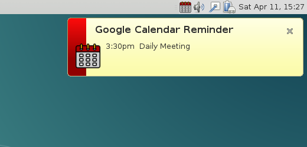

# GoogleCalendarReminder
Simple system tray agent will remind you about upcoming events from your Google Calendar

## Requirements

1. GNU/Linux (other operating systems are not tested)
2. [Python](https://www.python.org/) 3.4+
3. [PyQt6](https://www.riverbankcomputing.com/software/pyqt/)
4. [gcalcli](https://github.com/insanum/gcalcli) 3.1+
5. [libnotify](https://gitlab.gnome.org/GNOME/libnotify) (optional, for notify-send)

## Usage

1. Setup and configure [gcalcli](https://github.com/insanum/gcalcli).
2. Launch GoogleCalendarReminder
3. ...
4. PROFIT!

## Screenshots

